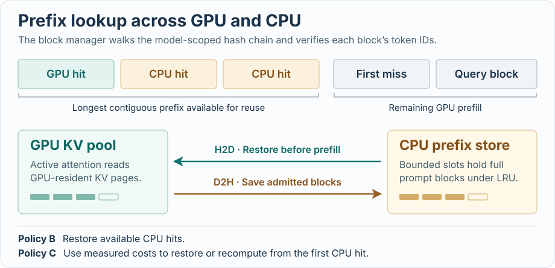
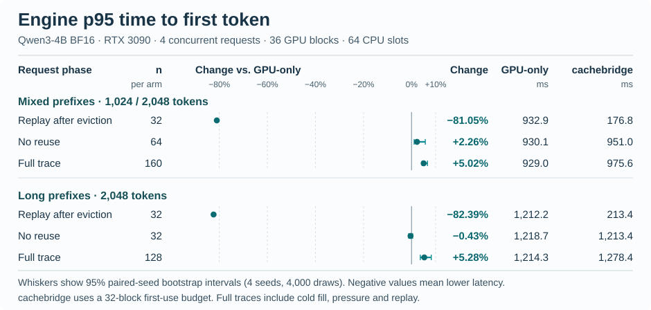

# cachebridge

当一段长对话的历史前缀被显存淘汰，再次收到这段前缀时，推理引擎需要重新计算它的 attention keys 和 values（KV）。cachebridge 在 CPU 内存中保留一份有容量上限的历史 KV。请求再次到来时，引擎可以把连续命中的块搬回 GPU，只计算剩余输入。模型权重和执行 attention 所需的活跃 KV 都在 GPU 上。

在单张 RTX 3090、Qwen3-4B BF16、并发 4 的混合前缀实验中，**GPU 淘汰后重放的 p95 首 token 延迟从 932.94 ms 降到 176.83 ms**（每策略 32 条）。保存 KV 也有成本。把冷填充、干扰和重放全部计入后，每策略 160 条请求的 p95 从 928.98 ms 升到 975.65 ms。[实验报告与原始数据](docs/STAGE2_FIRST_USE_BUDGET.md)

## 一次请求怎样复用 KV



1. **查找前缀。** 块管理器按顺序查找完整的 prompt 块，用模型与配置标识、前缀哈希链和 token IDs 校验内容。遇到第一个缺口就停止复用，并保留产生首个输出 token 所需的尾部查询。[块管理器](nanovllm/engine/cpu_prefix_cache.py)
2. **恢复或重算。** 策略 B 在 CPU 命中时恢复。策略 C 根据真实 KV 搬运和 prefill 的校准成本选路。恢复时先保留 GPU 目标块，复制完成后才发布新的可用前缀。[恢复策略](nanovllm/engine/restore_policy.py) · [KV 搬运](nanovllm/engine/kv_transfer.py)
3. **控制写入成本。** CPU 缓存按 LRU 淘汰。可设置首次写入额度，把其余空间留给已观测到复用的前缀。批量写入使用两块锁页暂存区，让相邻块的复制重叠。四种子对照里，32 块额度相对 36 块在每种负载的 8 个周期都少写了 1.125 GiB，两种负载各 16 条先淘汰再首次重放的请求仍全部恢复。[写入额度实验](docs/STAGE2_FIRST_USE_BUDGET.md)

## 性能与适用负载

下图对比同轮原生 GPU 前缀缓存 A 与 CPU 命中即恢复的配置。GPU 池 36 块，CPU 池 64 块，首次写入额度 32 块，每块 256 tokens。每轮 4 个请求，每条前缀追加 128 个输入 tokens 并生成 128 个 tokens。TTFT 从请求入队计到首个实际输出 token，包含排队、搬运与等待。四个种子使用相同输入和访问顺序，预热独立，正式测量关闭 profiler。



收益集中在**前缀已经离开 GPU、又被请求**的场景。混合负载使用 1024 和 2048-token 前缀，32 块组最慢的 8 条请求全部来自冷填充。对其无复用请求，p95 变化的配对种子 95% 区间为 +1.07% 至 +5.71%（每策略 64 条）。[固定输入、按种子结果和区间](docs/STAGE2_FIRST_USE_BUDGET.md#引擎内-p95-ttft)

成本模型还揭示了一个调度问题。在含冷请求的独立对照中，按当前 prefill 步估算的策略有 6 波选择重算。6 波的目标请求都更快，但同波 p95 全部升高。重算改变了哪些同伴能进入当前 prefill 步，策略评估因此同时记录目标延迟和整波延迟。[队列实验与决策记录](docs/STAGE2_STEP_COST.md)

## 在本机观察一次 CPU 恢复

已验证环境为 Linux / WSL2、单张 RTX 3090 24 GB、Python 3.12、PyTorch 2.10.0+cu128 和 FlashAttention 2.8.3。使用与 CUDA 匹配的现有环境，并将下方变量指向本地模型目录。正式实验的模型 revision 为 `1cfa9a7208912126459214e8b04321603b3df60c`。[模型版本](https://huggingface.co/Qwen/Qwen3-4B/tree/1cfa9a7208912126459214e8b04321603b3df60c)

```bash
git clone https://github.com/wangly228/cachebridge.git
cd cachebridge
python -m pip install -e .
export MODEL_DIR="$HOME/models/huggingface/Qwen3-4B"
```

下面的示例用固定 token IDs 把 GPU 池缩到 4 块，依次执行填充、无关请求、重放。这样只发 3 条请求，就能从计数器读到实际恢复量。

```python
import os
from nanovllm import LLM, SamplingParams

llm = LLM(
    os.environ["MODEL_DIR"],
    max_model_len=1024, max_num_seqs=1, max_num_batched_tokens=1024,
    max_kvcache_blocks=4, cpu_prefix_cache_blocks=8,
    enable_metrics=True, enforce_eager=True,
)
params = SamplingParams(temperature=0, max_tokens=1)
prefix = [1000] * 512
llm.generate([prefix + [101]], params, use_tqdm=False)
llm.generate([[2000] * 768 + [102]], params, use_tqdm=False)
llm.clear_metrics()
llm.generate([prefix + [103]], params, use_tqdm=False)

replay = next(iter(llm.request_metrics.values()))
print(replay.initial_gpu_hit_tokens, replay.cpu_restored_tokens, replay.prefill_tokens)
```

上述示例在 RTX 3090 上实测输出为 `0 512 1`，分别是 GPU 初始命中的 tokens、从 CPU 恢复的 tokens 和实际执行 prefill 的 tokens。正式性能实验使用 36 块 GPU 池和 CUDA Graph。[正式配置与复跑命令](docs/STAGE2_FIRST_USE_BUDGET.md#复跑)

## 复核结果

在已安装项目依赖的环境中，从仓库根目录可用逐请求日志重建主图的 p95 和置信区间。该命令读取归档，无需加载模型。

```bash
python -m benchmarks.first_use_budget_report results/20261119_first_use_budget36
```

- **数值正确性。** 87 个真实模型 KV 块在 GPU → CPU → GPU 后逐位一致。四种子额度对照中的 864 条 CPU 策略请求，在相同计算形状下与原生路径的全部 128 个 greedy 输出 token 一致。冷、热路径跨计算形状比较时，144 个位置仍有 6 个超过预设 BF16 阈值，上游复现了这 6 处。[阶段 1 验收](docs/STAGE1_ACCEPTANCE.md) · [额度对照核验](docs/STAGE2_FIRST_USE_BUDGET.md)
- **工程实现与测试。** 缓存身份、部分命中、共享块保护、容量和淘汰可从块管理测试读起。真实复制与同步有独立用例。[缓存测试](tests/test_cpu_prefix_cache.py) · [搬运测试](tests/test_kv_transfer.py)
- **下一步。** 在两波固定输入上分段计时，定位冷填充时模型 Runner 内的延迟波动。[冷填充分析与原始记录](docs/STAGE2_FIRST_USE_BUDGET.md#混合冷填充耗时分解)

## 来源与许可证

cachebridge 基于 nano-vLLM 的固定提交 `bb823b3`。GPU 前缀缓存、Chunked Prefill 和 CUDA Graph 来自上游。本项目实现了 CPU 缓存、KV 搬运与恢复选路，并提供逐请求测量和可回放的压力实验。代码采用 MIT 许可证，保留上游版权声明。[上游源码](https://github.com/GeeeekExplorer/nano-vllm/tree/bb823b3e06983d71485a8e1f23715ebd87d98ef8) · [MIT License](LICENSE)
