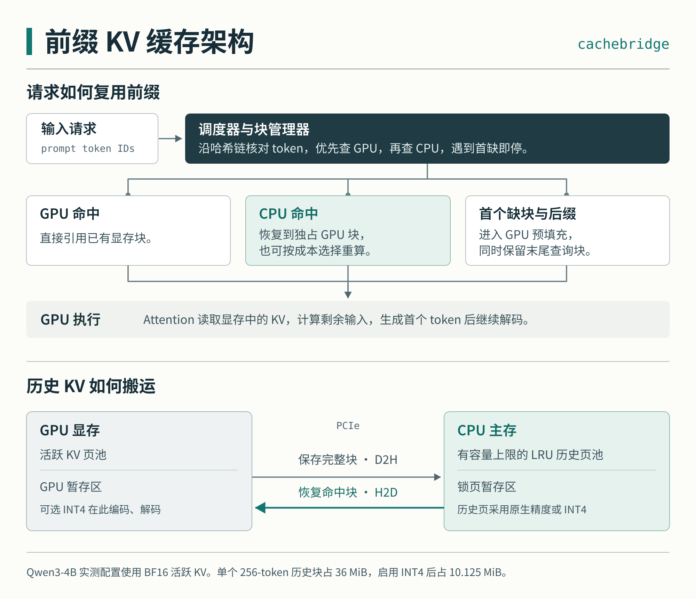
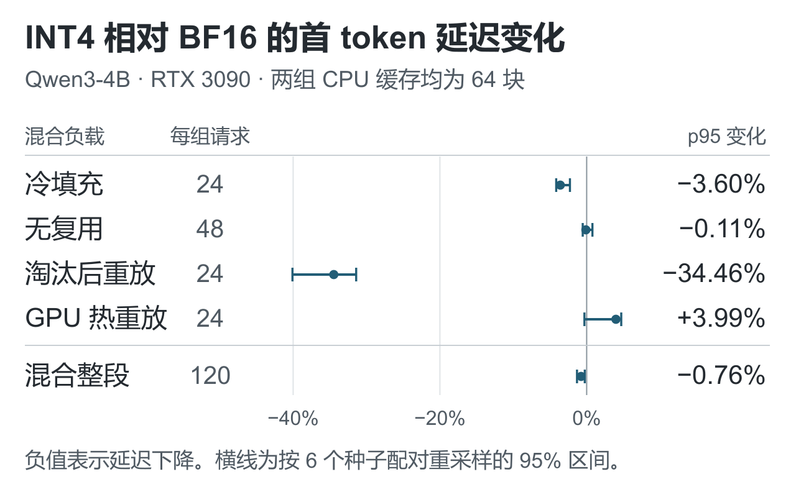

# cachebridge


cachebridge 在 nano-vLLM 上实现了有容量上限的 CPU 前缀缓存。多个请求反复使用同一段长前缀时，即使 GPU 已经淘汰了这段历史，引擎仍有机会跳过重算，更早给出第一个 token。

引擎把完整提示词块的 attention keys 和 values（KV）保存在主存中，按 LRU 淘汰。前缀再次出现时，引擎从头查找连续命中的块，将需要的 CPU 块恢复到显存，再计算剩余输入。模型权重和 attention 读取的活跃 KV 都留在 GPU。CPU 层可以使用原生精度，也可以用 INT4 打包后存储和搬运。

[](assets/cachebridge-system.svg)

## 在 RTX 3090 上测到了什么

单张 RTX 3090 24 GB，Qwen3-4B 权重和活跃 KV 使用 BF16。下图比较相同的 64 个 CPU 缓存块，唯一变化是历史块的存储格式。TTFT 从请求入队计到首个真实输出 token，包含排队、搬运和等待。



同一轮使用 6 个种子、并发 4、每请求输出 16 个 token。混合负载每组共 120 条请求，其中 24 条重放了已经离开 GPU 的前缀。重放 p95 从 **177.07 降到 116.05 ms**，整段 p95 从 **837.64 降到 831.29 ms**。整段最慢的请求集中在冷填充和无复用阶段。[正式结果与置信区间](results/20261123_int4_prefix_formal/summary.json)

| 换一个比较条件 | BF16 | INT4 |
| --- | ---: | ---: |
| 一个 256-token 历史块的 CPU 存储和单次 PCIe 搬运 | 36 MiB | 10.125 MiB |
| 648 MiB CPU 页池能容纳的完整块数 | 18 | 64 |
| 该预算下，容量压力实验中完整恢复的重访请求 | 24/96 | 96/96 |
| 这些重访请求的 p95 TTFT | 562.47 ms | 97.14 ms |

每个 INT4 块含 9 MiB 打包值和 1.125 MiB 分组缩放信息。一块实际省 **71.875%**。在相同页池预算下，由于能恢复更多块，容量实验的 CPU → GPU 总流量从 3.375 增到 3.797 GiB，同时少重算了 73,728 个输入 token。[字节核算与搬运记录](docs/INT4_PREFIX_CACHE.md#实际字节)

**默认保留 BF16。** 在 2,048 至 12,288-token 历史、64-token 回答上限下，单跳检索正确数从 16/18 到 18/18，两跳却从 13/18 降到 7/18。六道新增失分题在放宽输出上限后都答对了，但 INT4 用了更多 token 才给出验证码。历史重访多、能够容忍措辞变化时，可以试 INT4；回答预算紧或要求复现原文时，使用原生精度。[逐题结果与扩窗复查](docs/INT4_PREFIX_CACHE.md#独立长上下文质量)

## 用三条请求观察一次恢复

在有 CUDA 的 Linux 或 WSL2 环境安装项目，准备好本地 Qwen3-4B 模型目录。实测环境使用 Python 3.12、PyTorch 2.10.0+cu128 和 FlashAttention 2.8.3。[模型 revision](https://huggingface.co/Qwen/Qwen3-4B/tree/1cfa9a7208912126459214e8b04321603b3df60c)

```bash
git clone https://github.com/wangly228/cachebridge.git
cd cachebridge
python -m pip install -e .
export MODEL_DIR="$HOME/models/huggingface/Qwen3-4B"
```

下面把 GPU 缓存限制为 4 块。第一条请求留下 512 个前缀 token，第二条无关请求将它们挤出 GPU，第三条请求再使用同一前缀。

```python
import os
from nanovllm import LLM, SamplingParams

llm = LLM(
    os.environ["MODEL_DIR"],
    max_model_len=1024, max_num_seqs=1, max_num_batched_tokens=1024,
    max_kvcache_blocks=4, cpu_prefix_cache_blocks=8,
    enable_metrics=True, enforce_eager=True,
)
params = SamplingParams(temperature=0, max_tokens=1)
prefix = [1000] * 512
llm.generate([prefix + [101]], params, use_tqdm=False)
llm.generate([[2000] * 768 + [102]], params, use_tqdm=False)
llm.clear_metrics()
llm.generate([prefix + [103]], params, use_tqdm=False)

replay = next(iter(llm.request_metrics.values()))
print(replay.initial_gpu_hit_tokens, replay.cpu_restored_tokens, replay.prefill_tokens)
llm.exit()
```

原生精度示例在 3090 上输出 `0 512 1`，即 GPU 命中 0 个 token，从 CPU 恢复 512 个，实际只计算最后 1 个。要试用量化，在构造 `LLM` 时增加 `cpu_prefix_cache_format="int4"`。省略该参数使用模型原生精度；原生格式下将 `cpu_prefix_cache_blocks` 设为 0 可关闭 CPU 缓存。[正式实验使用的完整配置](docs/INT4_PREFIX_CACHE.md#启用方式和实际数据路径)

## 代码与复现

- 从 [块管理器](nanovllm/engine/cpu_prefix_cache.py) 可以看到完整块校验、连续前缀查找、LRU 和后台写入完成后的发布时机。[KV 搬运](nanovllm/engine/kv_transfer.py) 和 [INT4 编解码](nanovllm/engine/int4_cache.py) 负责实际数据复制。
- [冷请求合批实验](docs/STAGE2_COLD_PACK.md) 记录了另一次独立对照。让同波的冷请求使用剩余 prefill 预算后，混合整段 p95 从 927.27 降到 880.04 ms，每组 240 条请求；队首和队尾的等待变化见报告。
- [复跑命令](docs/INT4_PREFIX_CACHE.md#正确性复跑与范围)、[预设验收线](docs/INT4_PREFIX_PROTOCOL.md) 和[各阶段进度](docs/PROJECT_CONTEXT.md)均在仓库内。完整词表 logits 和 KV 张量可按报告中的 GPU 命令在本地生成，再运行离线审计。

cachebridge 基于 nano-vLLM 的 `bb823b3`，沿用上游 GPU 前缀缓存、Chunked Prefill 和 CUDA Graph。CPU 历史缓存、恢复策略和实验程序在此仓库实现。低比特页布局参考了 turboquant-vllm 的打包思路，本项目使用按 32 个坐标分组的对称量化。[nano-vLLM](https://github.com/GeeeekExplorer/nano-vllm/tree/bb823b3e06983d71485a8e1f23715ebd87d98ef8) · [turboquant-vllm 参考提交](https://github.com/Alberto-Codes/turboquant-vllm/tree/7b56dc97bb7aefd9bae684b40607b87290159b6b) · [MIT 许可证](LICENSE)
